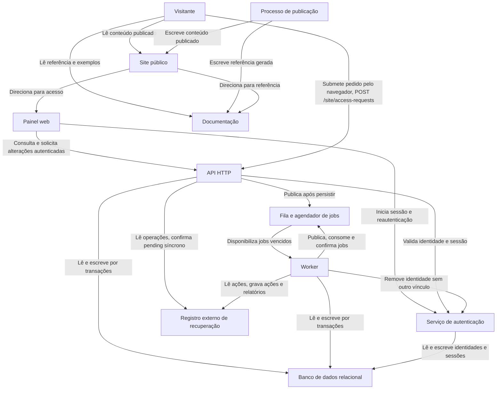

# Componentes e acesso aos dados

O diagrama mostra quem solicita leitura ou escrita: API HTTP e worker acessam dados de negócio e registro externo; o serviço de autenticação acessa suas tabelas; painel, site público e documentação não os acessam diretamente.

Site público e documentação são lidos pelo visitante e recebem conteúdo pelo processo de publicação. O formulário da landing pode executar no navegador `POST /site/access-requests` na API, com CORS próprio e sem sessão ou chave; a publicação estática não acessa o banco diretamente. A API decide e persiste o pedido e o aviso durável. O protótipo atual apenas simula essa submissão (DEC-005/008). O serviço de autenticação controla tabelas próprias de identidades e sessões no mesmo banco relacional e backup. Toda restauração invalida todas as sessões antes de reabrir.

A camada de aplicação é compartilhada pela API HTTP e pelo worker. Seus módulos tratam conta e acesso, agendamentos, mensagens, webhooks, privacidade e recuperação. São limites de código e de responsabilidade, sem exigir um processo por módulo. Adaptadores traduzem chamadas externas para os resultados estáveis do núcleo; não levam formatos do provedor às decisões de estado.

`appointments` e `appointment_events` sustentam estado e histórico; `inbound_messages`, `outbound_messages` e `message_attempts` sustentam o processamento de mensagens; `webhook_events`, `webhook_attempts` e `webhook_attempt_signatures` sustentam entrega. Conta, acesso e configurações residem em `accounts`, `account_users`, `api_keys`, `whatsapp_connections`, `webhook_endpoints`, `webhook_secrets` e `message_templates`. `contacts`, `contact_blocks` e `contact_privacy_events` mantêm privacidade; `durable_commands`, `recovery_outbox`, `notifications`, `retention_reports` e `retention_erasure_batches` sustentam execução e evidência; `monthly_usage` mantém consumo. `recovery_ledger`, `recovery_reports` e `recovery_report_entries` ficam exclusivamente no armazenamento externo.
