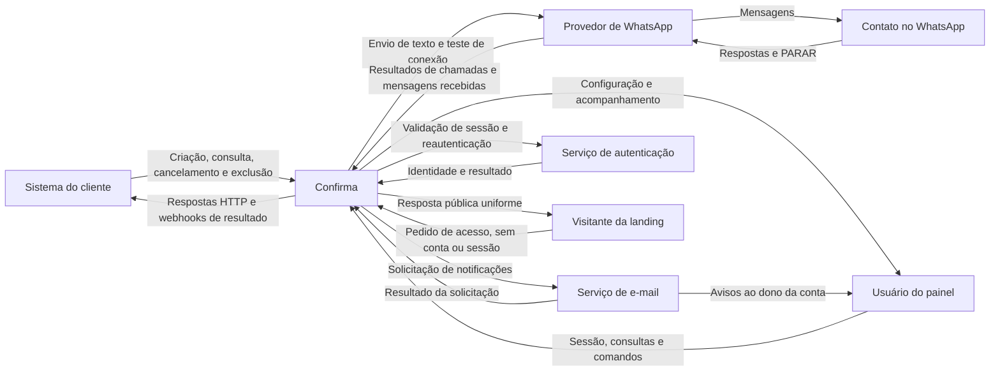

# Contexto e visão geral

O Confirma recebe agendamentos do sistema do cliente, conduz a confirmação pelo WhatsApp e comunica resultados por webhook. A API HTTP atende integrações e comandos do painel web; o worker executa envios, processamento temporal, entregas e manutenção; ambos compartilham a camada de aplicação que controla transações e isolamento por conta. O banco de dados relacional conserva o estado durável, enquanto a fila e agendador de jobs distribui trabalho recuperável. O serviço de autenticação identifica o usuário do painel, os adaptadores isolam o provedor de WhatsApp e o serviço de e-mail, e o registro externo de recuperação preserva ações que precisam sobreviver à restauração do banco. Site público e documentação publicam conteúdo sem acesso aos dados operacionais.

## Persistência da execução

O navegador do visitante também submete pedidos de acesso à API em `/site/access-requests`, com CORS próprio e sem chave ou sessão. O pedido antecede a conta; a API persiste a solicitação e o aviso durável conforme RF-026/DEC-008. O site estático não acessa o banco diretamente.

`durable_commands` mantém o trabalho junto da transação de negócio, e `recovery_outbox` mantém gravações externas posteriores à alteração local. O bloqueio usa `contact_blocks` com identidade por conta e `phone_hmac`; não exige contato para recuperação. `webhook_events.payload` guarda o corpo imutável. A mensagem fixa sua conexão somente no aceite ou na incerteza; cada tentativa registra a conexão que usou.

## Contexto

O diagrama mostra as fronteiras do Confirma e o sentido das comunicações, incluindo o contato que interage por intermédio do provedor de WhatsApp.

O sistema do cliente continua responsável por aplicar o resultado à própria agenda. A aceitação de uma chamada pelo provedor não comprova entrega no aparelho. O webhook de resultado tem como destino o receptor externo configurado pelo cliente; o recebimento de mensagens do provedor é uma superfície do Confirma.
