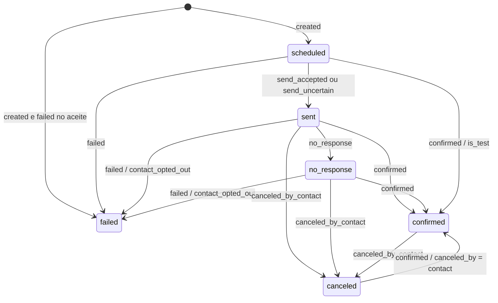
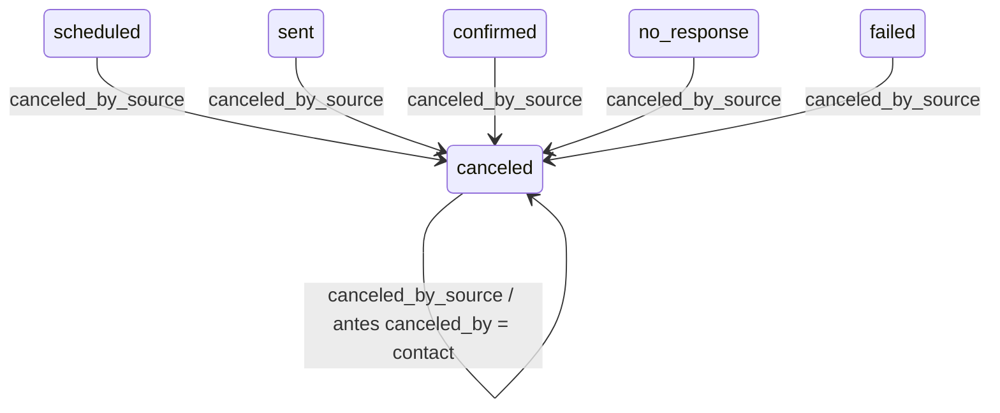

# Estados do agendamento

O diagrama mostra as transições de envio, resposta, expiração, bloqueio e simulação usando os seis estados persistidos de `appointments.current_status`.

O diagrama mostra o cancelamento pela origem a partir de qualquer estado, incluindo a mudança de origem que mantém o nome `canceled`.

As transições do contato exigem telefone desbloqueado, agendamento alterável e consulta ainda não iniciada. `canceled_by = system` impede retorno por resposta. Cancelamento pela origem exige consulta não iniciada; sua repetição não cria outra transição. `failed` não aceita resposta, mas admite cancelamento pela origem. A passagem do horário da consulta congela respostas, sem criar outro estado. Lembrete, retentativa, falha de webhook e `personal_data_erased` não acrescentam estados; a exclusão retira o registro da consulta. Os nomes públicos correspondem a agendado, enviado, confirmado, cancelado, sem resposta e falha, respectivamente.
