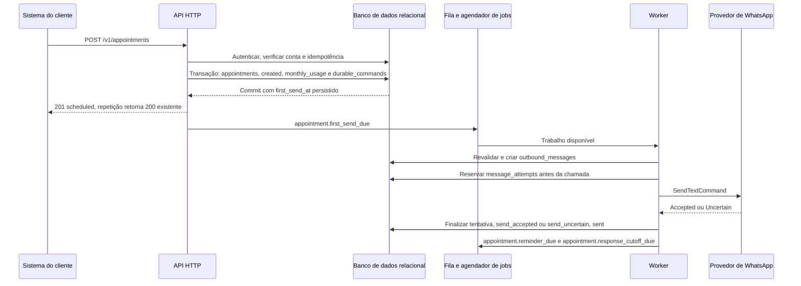

# Fluxo de agendamentos

As transações indicadas incluem os comandos em `durable_commands`. Publicar na fila acontece depois da confirmação; uma falha nessa publicação é corrigida pela reconciliação. Chamadas externas ocorrem fora da transação, após uma reserva persistida e uma última verificação de elegibilidade.

## Criar agendamento e realizar o primeiro envio

O diagrama mostra o aceite durável separado do envio e a persistência do resultado da tentativa antes de disponibilizar os próximos trabalhos.

A entrada direta em `failed` grava `failed` e `webhook_events` na transação da criação, sem trabalho de WhatsApp. A simulação grava `confirmed` e `appointment.confirmed` após seu atraso, sem chamar o provedor. Primeiro envio e simulação usam a mesma proteção de concorrência do agendamento; a simulação não reserva uso em `monthly_usage`.
