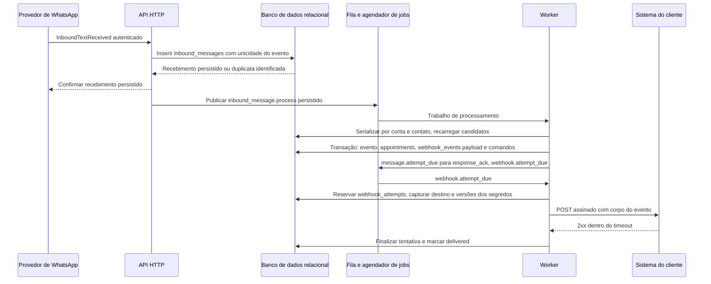
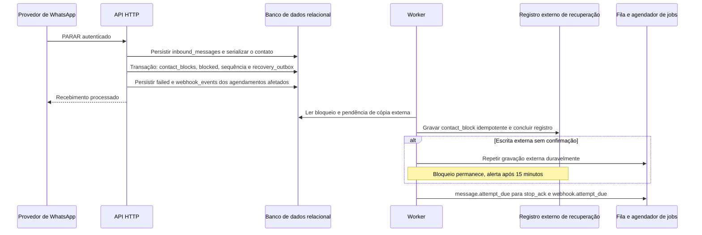
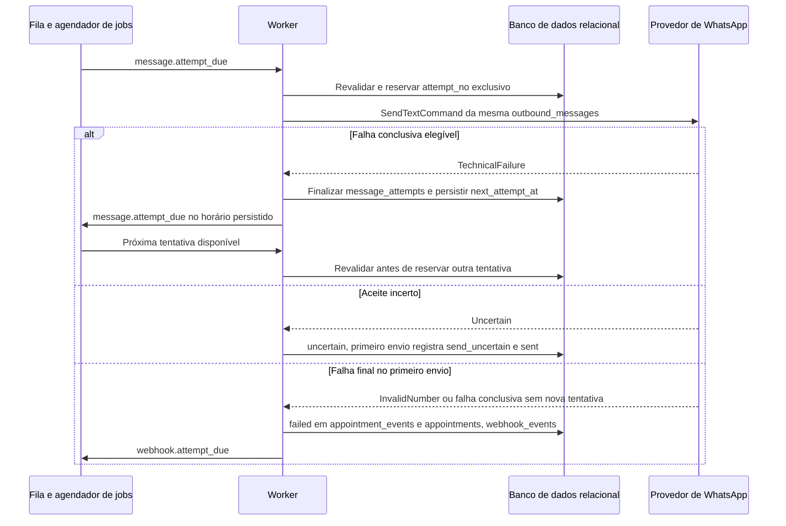

# Fluxo de mensagens e webhooks

## Resposta do contato e webhook de resultado

O diagrama mostra a deduplicação na entrada e a separação entre mudança de resultado e entrega do webhook correspondente.

A serialização usa `received_at` e UUID interno como desempate. Atualizar `appointments`, inserir `appointment_events` e criar `webhook_events` é uma só transação. O evento de saída é `appointment.confirmed` ou `appointment.canceled`; sua sequência vem do histórico do agendamento e não precisa ser contígua entre webhooks. Respostas sem mudança não criam outro evento. A mensagem `response_ack` é um trabalho independente e sua falha não desfaz o resultado.

## PARAR

O diagrama mostra que o bloqueio local não espera pelo registro externo e que sua cópia é retomável sem permitir novos envios indevidos.

O tratamento de `PARAR` compartilha a serialização por conta e `phone_hmac` das outras mensagens e aplica o bloqueio sem depender da disponibilidade da fila. O bloqueio e os efeitos nos agendamentos são coordenados com as reservas de tentativa no banco. `stop_ack` é a exceção explícita ao bloqueio de mensagens; possui identidade própria e não é recriado para a repetição do comando. A cópia pendente reside em `recovery_outbox`, escrita atomicamente com o bloqueio. A recuperação cria `contact_blocks` só com conta e HMAC se não houver contato; criação e recebimento consultam essa chave e vinculam o contato quando o telefone reaparecer.

## Falha de envio com retentativa

O diagrama mostra que uma nova tentativa depende de falha conclusiva, estado persistido e nova verificação, enquanto a incerteza encerra as tentativas daquela mensagem.

O worker calcula o intervalo da política de mensagens a partir do término da falha anterior e aplica os horários congelados do agendamento. A fila não usa uma política genérica que possa repetir a chamada ignorando `message_attempts`. Falha de lembrete produz `reminder_failed`; mensagens de resposta mantêm seu resultado técnico nas tentativas. Nenhuma delas converte por si só o agendamento em `failed`. Antes de aceite ou incerteza, `outbound_messages.connection_id` é nulo e cada `message_attempts.connection_id` registra a conexão vigente usada. A troca marca a antiga `replacing`, impede chamadas novas e aguarda as iniciadas. A credencial de envio é apagada quando nenhuma chamada resta. Aceite anterior fixa a mensagem na conexão antiga; falha permite tentativa na nova.
