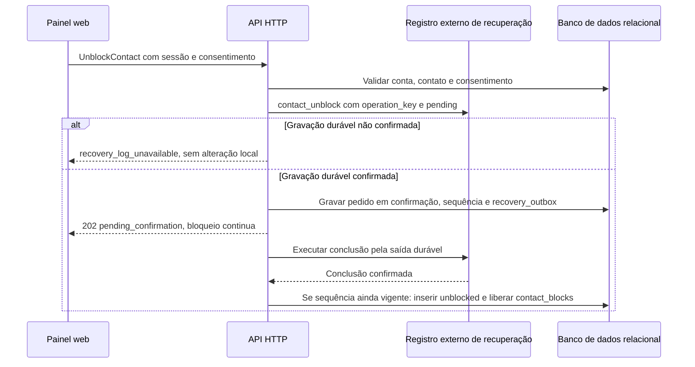
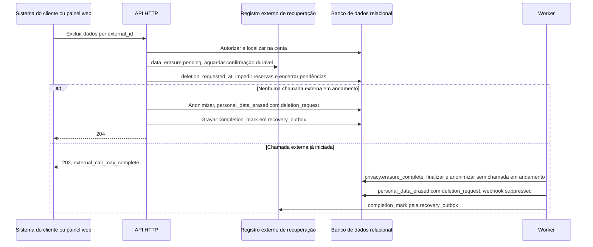
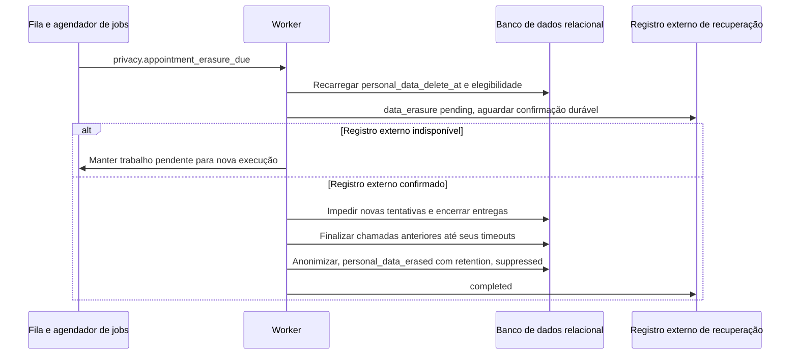

# Fluxo de privacidade

## Desbloqueio

O diagrama mostra o desbloqueio em confirmação e sua efetivação após confirmação externa, sem liberar o bloqueio durante a espera.

O desbloqueio não muda `appointments` em `failed`. A reconciliação repete `completion_mark` até confirmar e só então efetiva o desbloqueio. PARAR de sequência maior cancela o pedido em confirmação. Operações restritivas, por sua vez, preservam o efeito local e respondem sucesso mesmo se `completed` falhar; a marcação é repetida e gera alerta após 15 minutos.

## Exclusão antecipada

O diagrama mostra a barreira contra novas tentativas e a conclusão da exclusão quando uma chamada anterior ainda está em andamento.

Registro ausente ou já excluído retorna 204 sem criar trabalho de remoção. O evento `personal_data_erased` é auditoria interna, não um webhook; não existe estado público de exclusão. A reserva da chamada e `deletion_requested_at` usam a mesma coordenação transacional, evitando que uma leitura anterior autorize envio depois da barreira. Uma chamada que já cruzou essa fronteira pode terminar. A anonimização preenche `anonymized_at`, remove conteúdo e `contact_id` das mensagens e mantém `appointment_id` até o expurgo. `source_message_id` no evento de privacidade é informativo e não impede expurgo. Se o finalizador cair, o comando de exclusão é retomado após a reserva de 60 segundos expirar.

## Exclusão por retenção

O diagrama mostra a mesma barreira de exclusão acionada pelo prazo persistido, com dependência explícita da confirmação do registro externo.

O processamento também seleciona prazos de mensagens sem agendamento, segredos, conexões e auditoria. Mantém bloqueios e consentimentos independentes do agendamento e preserva o consumo em `monthly_usage`. O expurgo dos backups é uma tarefa operacional separada. A indisponibilidade do registro externo pode atrasar a remoção física; o prazo vencido impede consulta e reenvio, sem declarar remoção nem estender a retenção. Após 15 minutos de indisponibilidade há alerta; após 24 horas com vencidos, urgência; após 72 horas, incidente para documentação de privacidade. `retention_reports` registra diariamente quantidade e vencimento mais antigo sem dados pessoais, e `retention_erasure_batches` registra datas reais dos lotes, processados do mais antigo ao mais novo.
