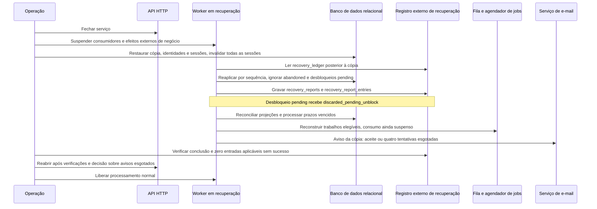

# Fluxo de recuperação

## Restauração de backup

O diagrama mostra a restauração com tráfego fechado e envios suspensos até a reaplicação, reconciliação e verificação do relatório externo.

A recuperação considera `data_erasure`, `contact_block`, `contact_unblock`, `api_key_revocation`, `source_cancel` e `account_delete`. Relatórios mantêm resultados `reapplied`, `already_effective`, `discarded_pending_unblock`, `discarded_abandoned` ou `failed`, com totais por tipo. Exclusões de conta também removem vínculos e identidades sem outra conta. A recuperação não aplica entradas `abandoned`; relata restritivas reaplicadas que estavam `pending` havia menos de 15 minutos. Avisos de recuperação precisam de aceite pelo serviço de e-mail ou quatro tentativas esgotadas; com indisponibilidade persistente, o operador decide reabrir com alerta. Se o operador reabrir o serviço com alerta, começa um único ciclo de continuação: 1 tentativa a cada 24 horas, até 7 tentativas, numeradas de 5 a 11 na mesma sequência do aviso. A identidade é a do próprio aviso de recuperação, sem aviso novo, e a chave de idempotência de cada tentativa é o identificador do aviso mais o número da tentativa. O ciclo termina na primeira entrega confirmada ou quando o operador encerrar a indisponibilidade. Esgotadas as 7 tentativas sem entrega, o aviso fica abandonado e gera um `operational_alert`. A recuperação não restaura respostas nem entregas ausentes da cópia; os consumidores de webhook precisam suportar o cenário excepcional de IDs novos e sequências repetidas.
