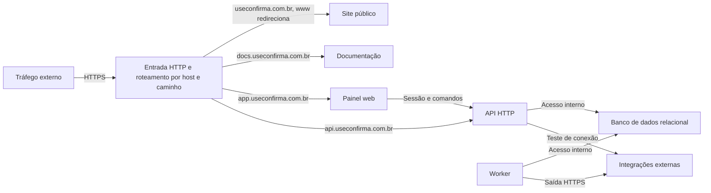

# Implantação por papéis

API HTTP e worker são processos separados e compartilham a camada de aplicação e as políticas de domínio. Os módulos de negócio rodam juntos dentro desses processos. O worker tem modos de consumo, agendamento, manutenção e recuperação; agendamento e supervisão devem continuar observáveis independentemente de uma execução de envio bloqueada. No piloto, API, worker, banco, fila e proxy são processos separados numa única máquina, sem alta disponibilidade. Uma queda da máquina interrompe o serviço até restauração; o backup diário fica fora dela.

O banco de dados relacional e a fila têm acesso interno. O registro externo de recuperação fica isolado do conjunto de restauração do banco, inclusive quanto à operação que seleciona e restaura cópias. As chaves de criptografia ficam fora do banco, e a chave HMAC de recuperação fica fora de ambos os armazenamentos. A chave que calcula o HMAC do e-mail em `login_attempts` é própria dessa finalidade, diferente da de `phone_hmac`, e também fica fora do banco, no armazenamento de segredos. Site público e documentação usam hospedagem estática separada. O registro externo usa provedor e local independentes da máquina principal. O painel entrega sua interface nesse papel de apresentação; suas operações de negócio chegam à API HTTP. Identidades e sessões ficam no mesmo banco e backup; restauração invalida todas as sessões.

Os endereços abaixo usam o domínio `useconfirma.com.br`; o site público atende no domínio principal e `www.useconfirma.com.br` redireciona para ele. As superfícies da origem da API são `/v1`, `/panel`, `/auth`, `/inbound` e `/site`, com autenticação e limites próprios.

| Endereço | Destino | Tráfego |
| --- | --- | --- |
| `https://useconfirma.com.br` | Site público | Apresentação e documentos públicos. |
| `https://www.useconfirma.com.br` | Redirecionamento | Redireciona para `https://useconfirma.com.br`. |
| `https://docs.useconfirma.com.br` | Documentação | Referência da API e orientações de integração. |
| `https://app.useconfirma.com.br` | Painel web | Interface; sessão e reautenticação em `api.useconfirma.com.br/auth`, comandos em `/panel`. |
| `https://api.useconfirma.com.br/v1` | API HTTP | Somente chave de API; cookie não autentica. |
| `https://api.useconfirma.com.br/panel` | API HTTP | Somente sessão; chave de API não autoriza comandos. |
| `https://api.useconfirma.com.br/auth` | Serviço de autenticação | Autenticação e reautenticação. |
| `https://api.useconfirma.com.br/inbound` | API HTTP | Recebimento com segredo próprio por conexão. |
| `https://api.useconfirma.com.br/site` | API HTTP | Pedidos de acesso do site; aceita só a origem `https://useconfirma.com.br`. |

O diagrama mostra o roteamento público para conteúdo, painel e API, enquanto worker e banco permanecem fora da entrada pública.

A entrada valida transporte cifrado e aplica o limite de corpo antes do processamento da API. Autenticação e autorização continuam na aplicação. O cookie de sessão é restrito ao host `api.useconfirma.com.br`, sem atributo `Domain`, com `HttpOnly`, `Secure` e `SameSite=Lax`; CORS com credenciais libera somente `https://app.useconfirma.com.br`, sem curingas. `/panel` exige checagem de `Origin` e cabeçalho personalizado ou token anti-CSRF. O tráfego de saída do worker alcança provedor de WhatsApp, receptores de webhook e serviço de e-mail com validação de certificados e destinos. Ambientes de testes usam dados e credenciais separados de produção e adaptadores substituíveis para falhas simuladas. A implantação deve permitir fechar a API e suspender os efeitos externos de negócio durante a recuperação sem impedir o acesso operacional ao registro externo e o envio do aviso de restauração.

Os webhooks de entrada e o recebimento do provedor usam `https://api.useconfirma.com.br/inbound/<identificador-opaco>`. Webhooks de resultado são enviados pelo worker do Confirma para a URL externa configurada pelo cliente; essa URL de destino não é substituída pelo domínio do Confirma.

O e-mail transacional usa o Resend, conforme a [stack tecnológica](stacks.md), e o domínio remetente `mail.useconfirma.com.br`. SPF, DKIM e DMARC devem estar configurados para autenticar esse envio; os valores dos registros dependem do Resend.
