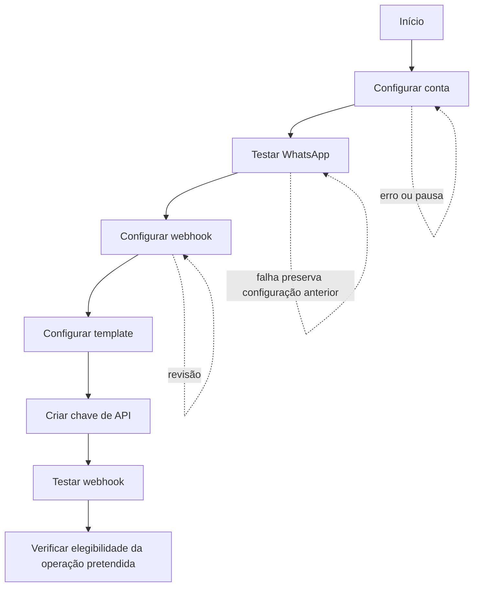

# Jornadas do usuário

## J-01 — Convite e primeiro acesso

**Objetivo:** criar o primeiro vínculo conta/usuário e abrir uma sessão válida.

**Ator e gatilho:** convidado recebe o e-mail do piloto; o link vale 7 dias e usa `https://app.useconfirma.com.br/convite#{token}`.

**Pré-condições:** convite criado pela equipe do Confirma; token disponível no fragmento.

**Sequência principal:** abrir convite; ler o token no cliente; executar `InspectInvitation`; apresentar e-mail e nome sugerido; informar nome da conta e senha; marcar aceite de termos/política; enviar `AcceptInvitation` com versões vigentes; criar conta, vínculo, senha, aceite e sessão em uma transação; entrar em `/boas-vindas`; selecionar **Começar configuração**; entrar em `/primeiros-passos`.

**Alternativas/erros:** token inválido/expirado/usado resulta em `invitation_invalid`; senha fora de 10–128 ou comum resulta em `weak_password`; versões desatualizadas exigem nova leitura e reenvio; campos inválidos não criam conta; concorrência permite apenas uma aceitação.

**Conclusão:** sessão aberta, conta `active`, primeiro aceite registrado, boas-vindas apresentada e onboarding disponível. A apresentação não cria nova condição de acesso nem altera a ordem das configurações.

**Retomada e variações:** se a conta já tiver iniciado a configuração, a introdução pode ser omitida e o usuário segue para `/primeiros-passos` com as etapas salvas. Se a sessão expirar, interromper a navegação, preservar o que foi enviado e exigir login; não repetir automaticamente uma operação sensível. Não existe marcador persistente próprio da apresentação; os acessos recorrentes seguem os estados existentes de sessão, autorização e operação.

Referências: RF-025, CU-020/021, DEC-003, contrato do painel.

## J-02 — Login e recuperação de acesso

**Objetivo:** entrar ou recuperar a senha de um usuário existente.

**Sequência principal:** abrir `/entrar`; informar e-mail e senha; em senha correta abrir sessão; em falha manter mensagem indistinguível para e-mails existentes e inexistentes. Para recuperação, solicitar e-mail; mostrar resposta uniforme; abrir link de uso único válido por 1 hora; definir senha válida e voltar ao login.

**Alternativas:** após cinco tentativas erradas consecutivas, bloquear a entrada por 15 minutos; link inválido, expirado ou usado exige novo pedido; sessão expirada retorna ao login. Referência: RF-025.

## J-03 — Onboarding até conta operacional

**Objetivo:** conduzir a conta pelos requisitos reais de operação.

**Sequência principal:** (1) revisar nome, fuso, antecedência e janela; (2) configurar e testar WhatsApp; (3) configurar URL e segredo de webhook; (4) configurar template; (5) criar chave de API; (6) testar webhook pelo painel; (7) orientar teste simulado via API ou teste real pelo integrador; (8) entrar na operação.

As etapas podem ser interrompidas e retomadas. Configuração salva e etapa com erro devem permanecer identificáveis. A elegibilidade é verificada por operação pelo backend; a conclusão visual desta sequência não autoriza indiscriminadamente todas as operações. O contrato não exige editar o template nem criar uma chave especificamente nesta sequência visual; `/v1` sempre exige chave válida da conta para criação real e simulação. A API exige provedor previamente configurado e URL de webhook para criação real; uma desconexão posterior não impede aceitar a criação. A [matriz de pré-condições](../../../dominio/pre-condicoes.md) formaliza as distinções e os limites ainda pendentes.

## J-04 — Consulta operacional e investigação de falha

**Objetivo:** localizar um agendamento, entender seu resultado e distinguir falha de confirmação de falha de entrega.

**Sequência:** abrir visão geral ou lista; filtrar/selecionar agendamento; abrir detalhe; ler status público, motivo, incerteza, histórico, tentativas e situação do webhook; quando houver `delivery_failed`, solicitar uma única redelivery; quando a causa for configuração, corrigir na integração. A alteração do sistema de agenda continua fora do painel.

**Alternativas:** registro retido/anonimizado não é consultável; reenvio entregue ou em retentativa não é oferecido; chamada concorrente mantém uma única tentativa; falha de reenvio deixa a ação disponível.

## J-05 — Reenvio manual de webhook

**Gatilho:** evento em `delivery_failed`, não anonimizado e sem entrega em andamento.

**Sequência:** detalhe identifica o evento; usuário solicita; servidor reserva uma tentativa; painel acompanha; resultado é sucesso ou falha registrada. A tentativa preserva evento, corpo lógico, ocorrência e sequência, usa URL/segredos vigentes e não inicia novo ciclo.

## J-06 — Substituição do WhatsApp

**Sequência:** abrir integração; informar instância, número e credenciais; salvar; serviço testa em até 10 segundos e lê versão; em sucesso ativa nova conexão, marca anterior `replacing` e informa homologação; em falha preserva anterior. Chamadas antigas terminam em até 15 segundos; novos envios usam a conexão vigente; respostas de compromissos enviados pela antiga permanecem aceitas até o início da consulta.

## J-07 — Rotação do segredo de webhook

**Sequência:** abrir webhook; solicitar rotação; confirmar consequência; receber segredo completo uma vez; guardar no integrador; durante 24 horas o receptor aceita assinaturas nova e anterior; depois a anterior deixa de ser válida. O painel nunca mostra o segredo novamente.

## J-08 — Chaves de API

**Criação:** solicitar criação, receber segredo completo uma única vez, copiar e reconhecer que não poderá recuperá-lo; a listagem passa a mostrar somente ID, prefixo, criação e revogação.

**Rotação:** criar nova chave, atualizar o integrador fora do Confirma, revogar a anterior. Falha do registro externo não revoga.

## J-09 — Desbloqueio de contato

**Sequência:** consultar telefone; se bloqueado, informar método e data do novo consentimento; validar que a data não é futura nem anterior ao último `PARAR`; registrar pendência externa; mostrar `pending_confirmation` sem liberar o bloqueio; após `completed`, efetivar `unblocked` se não houver `PARAR` posterior. O desbloqueio não reativa agendamentos em falha.

**Alternativas:** telefone não bloqueado mostra `contact_not_blocked`; registro externo indisponível retorna `recovery_log_unavailable`; novo `PARAR` cancela a pendência.

## J-10 — Exclusão de dados de agendamento

**Sequência:** abrir detalhe; solicitar exclusão antecipada; confirmar efeito; executar `EraseAppointmentData`; se não houver chamada externa, concluir e retirar dados; se houver, mostrar `PendingExternalCall` e que a chamada já iniciada ainda pode terminar. Não iniciar novas tentativas, não criar webhook de exclusão e permitir reutilização posterior do `external_id`.

## J-11 — Aceite de novos termos

**Sequência:** ao acessar com versão pendente, bloquear comandos; mostrar versões e links; usuário aceita `AcceptTerms` e retorna à intenção anterior. Pode sair ou iniciar exclusão de conta. API `/v1` não é bloqueada.

## J-12 — Exclusão definitiva da conta

**Sequência:** abrir rota sensível; reautenticar; digitar nome exato normalizado; confirmar; registrar operação externa e responder aceitação assíncrona; conta passa a `deleting`, interrompe novos comandos e encerra trabalhos; dados, vínculos e eventualmente identidade são removidos; e-mail de conclusão é enviado depois. Não há cancelamento nem recuperação.

Referência: RF-023, CU-019. A restauração de backup é responsabilidade operacional fora do painel.
