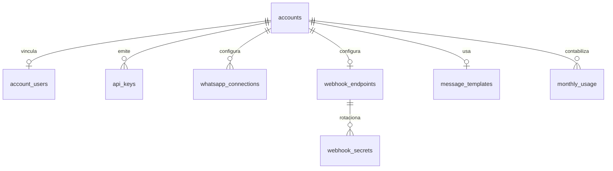
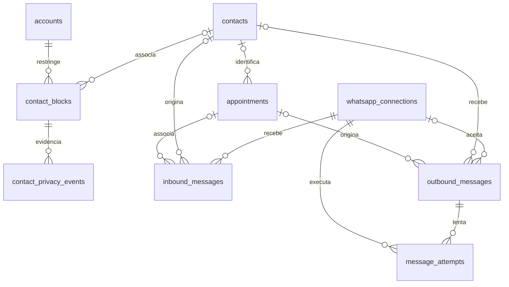
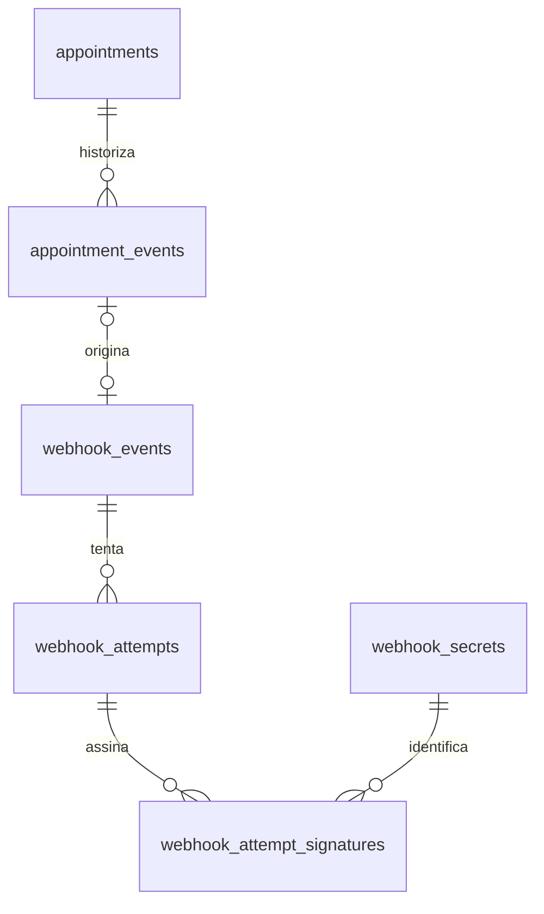
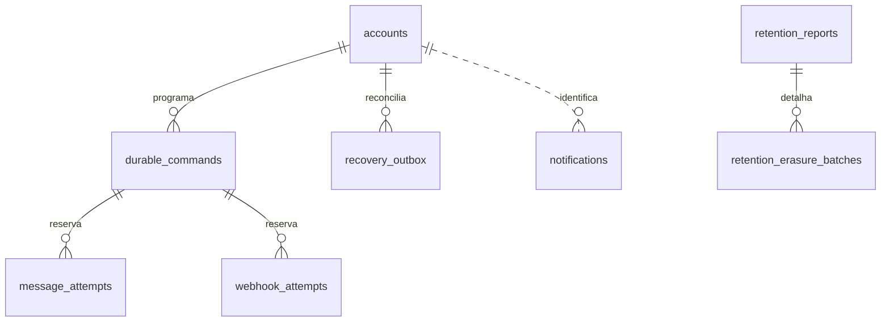
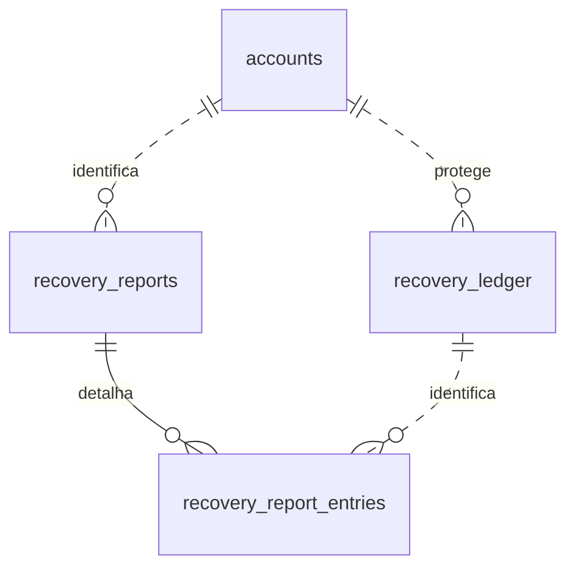

# Modelagem de dados do Confirma

## Objetivo

Este diretório descreve o modelo relacional do MVP. A proposta usa PostgreSQL como referência para tipos, restrições, índices parciais e JSONB. Ela não determina ORM, biblioteca de migração ou infraestrutura de implantação.

O modelo mantém a fonte transacional em terceira forma normal. Projeções usadas pela fila e pelas consultas ficam identificadas como desnormalizações deliberadas e têm uma fonte canônica e uma regra de reparo.

## Princípios

- Toda informação pertencente a um cliente carrega `account_id`. A própria linha de `accounts` representa seu limite de isolamento.
- Relações entre dados da conta usam chaves estrangeiras compostas `(account_id, id)`. Assim, um identificador de outra conta não pode ser associado por engano.
- Identificadores internos usam UUID e não contêm significado de negócio.
- Instantes são armazenados em `timestamptz`; fusos configuráveis usam nomes IANA, como `America/Sao_Paulo`.
- Estados e motivos são valores controlados por `CHECK` ou tipos equivalentes. A aplicação não grava valores livres nesses campos.
- O histórico de agendamentos é somente de inserção. Correções produzem novos eventos.
- Conteúdo pessoal em JSONB segue a mesma retenção dos campos pessoais explícitos.
- O registro usado após restauração fica em armazenamento separado do banco incluído no backup principal.

## Áreas do modelo

| Área | Tabelas principais |
| --- | --- |
| Conta e acesso | `accounts`, `account_users`, `account_invitations`, `login_attempts`, `terms_acceptances`, `api_keys` |
| Configuração | `whatsapp_connections`, `webhook_endpoints`, `webhook_secrets`, `message_templates` |
| Contato e privacidade | `contacts`, `contact_blocks`, `contact_privacy_events` |
| Confirmação | `appointments`, `appointment_events`, `inbound_messages`, `outbound_messages`, `message_attempts` |
| Webhooks | `webhook_events`, `webhook_attempts` |
| Processamento | `durable_commands`, `recovery_outbox`, `notifications`, `retention_reports`, `retention_erasure_batches` |
| Uso | `monthly_usage` |
| Pedidos de acesso | `access_requests`, sem `account_id`, porque o pedido antecede a conta; `account_invitations`, `login_attempts` e `operator_actions` também não têm conta |
| Recuperação | `recovery_ledger`, `recovery_reports`, `recovery_report_entries` em armazenamento externo |

## Diagramas

### Conta e configuração

O diagrama mostra a conta, seu acesso e configurações, incluindo a linha mínima de conta que pode permanecer após exclusão.

### Privacidade e mensagens

O diagrama mostra o bloqueio independente do contato e as referências opcionais que permitem anonimizar mensagens sem apagar sua linha mínima.

### Histórico e entrega de webhook

O diagrama mostra a separação entre evento canônico, payload de entrega e tentativas, incluindo o teste isolado sem evento de agendamento.

### Execução e evidência operacional

O diagrama mostra a fonte durável dos trabalhos e as evidências sanitizadas de notificação e retenção; a relação com notificações é informativa.

### Recuperação externa

O diagrama mostra o registro e os relatórios externos, com relações lógicas que não dependem de chaves estrangeiras para o banco restaurado.

`recovery_ledger`, `recovery_reports` e `recovery_report_entries` aparecem pela relação lógica, mas residem fora do banco restaurado e não possuem chaves estrangeiras físicas para ele. `webhook_attempt_signatures` evita guardar uma lista de segredos numa única coluna e mantém a primeira forma normal durante a rotação.

## Estado e eventos

`appointment_events` é a fonte canônica da evolução do agendamento. Cada evento recebe uma sequência crescente dentro do agendamento. O corpo de webhook é preservado integralmente em `webhook_events.payload`. A coluna `appointments.current_status` é uma projeção transacional desse histórico para fila e consultas; ela é atualizada na mesma transação que insere o evento.

As tentativas de mensagem e webhook têm sequências próprias dentro de seus objetos. Retentativa preserva a identidade da mensagem ou do evento entregue. Uma mudança de resultado cria um novo evento de agendamento e, quando notificável, um novo evento de webhook.

## Isolamento por conta

Cada tabela pertencente ao cliente contém `account_id`. As tabelas usam `UNIQUE (account_id, id)` mesmo quando `id` já é a chave primária, para permitir referências compostas. Toda chave estrangeira entre dados do cliente inclui `account_id`.

Consultas da aplicação sempre recebem a conta autenticada como predicado. Recomenda-se complementar as restrições com Row Level Security no PostgreSQL, usando o contexto da conta por transação. RLS é uma defesa adicional; não substitui as chaves compostas.

`accounts` é a exceção estrutural: seu próprio `id` é o `account_id`. Não existe uma conta acima dela no MVP.

## Normalização

O desenho atende à terceira forma normal:

1. colunas armazenam valores atômicos; listas variáveis viram linhas relacionadas;
2. atributos dependem da chave completa da relação, inclusive nas chaves compostas por conta;
3. configurações, tentativas, histórico, contato e eventos de entrega ficam em tabelas próprias, evitando dependências transitivas no agendamento.

As exceções intencionais estão em [desnormalizacoes.md](desnormalizacoes.md). A especificação completa das tabelas está em [tabelas.md](tabelas.md). As decisões de produto que surgiram durante a modelagem já foram incorporadas a esses documentos.

## Convenções de exclusão

- `RESTRICT`: impede remover a linha enquanto existirem dependências.
- `CASCADE`: remove dependências técnicas quando a linha proprietária é removida por um processo já autorizado.
- `SET NULL`: preserva histórico ao remover a referência operacional.
- Anonimização: apaga dados pessoais e identificadores externos, mantendo o mínimo de auditoria.
- Expurgo: remoção física depois do prazo de retenção.

Na exclusão de conta, o pedido entra em processamento, impede novas tentativas e aguarda chamadas externas já iniciadas. Depois, os dados dependentes são apagados e `accounts` mantém ID, datas de criação e exclusão e resultado técnico do aviso de conclusão por 12 meses, sem endereço. A entrada externa de exclusão impede que uma restauração recrie a conta.

## Persistência e recuperação

Identidades e sessões do serviço de autenticação ficam em tabelas próprias no mesmo banco e backup. Toda restauração invalida todas as sessões. `durable_commands` é a fonte de execução; `recovery_outbox` conserva gravações externas a confirmar. A privacidade usa `(account_id, phone_hmac)`, sem exigir contato recuperável. As mensagens anonimizadas mantêm `appointment_id`, datas e estados até o expurgo; conteúdo e contato ficam nulos.
